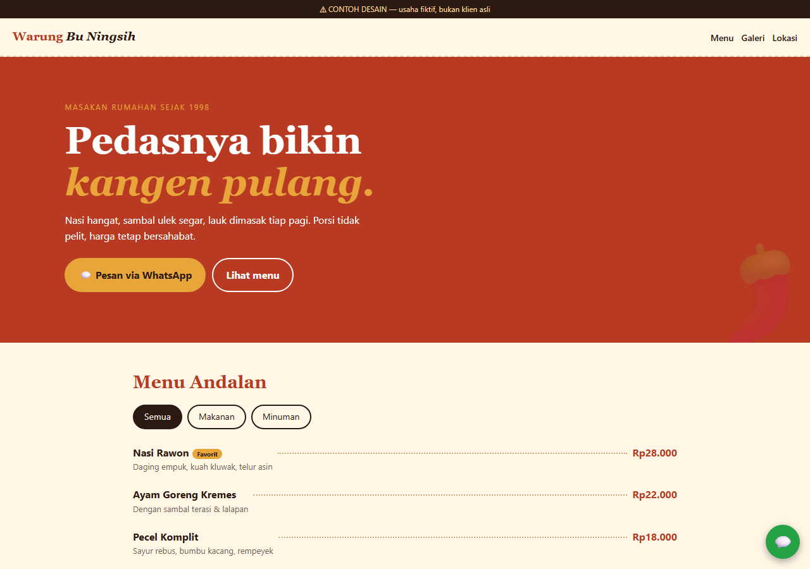
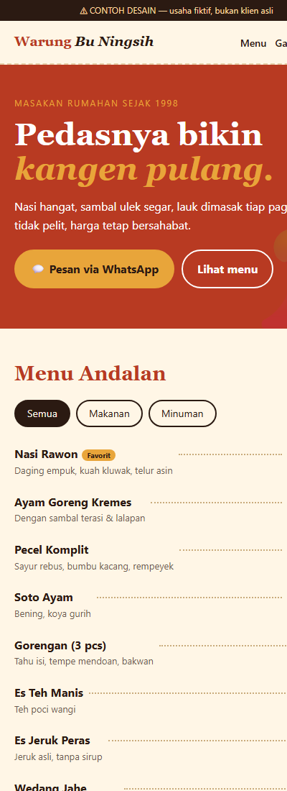
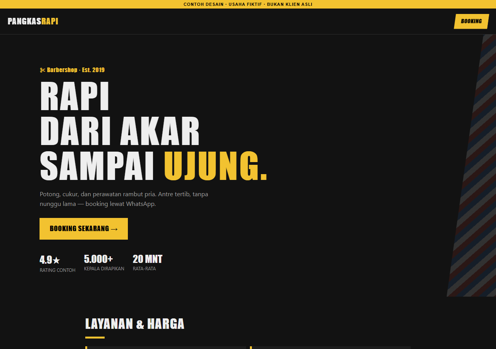
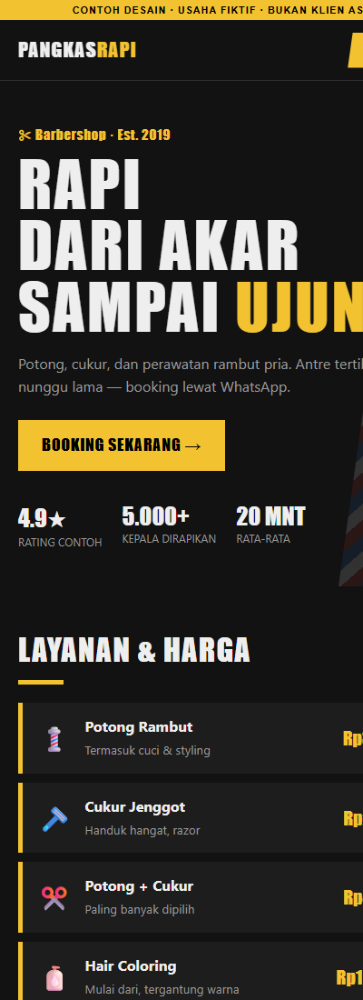
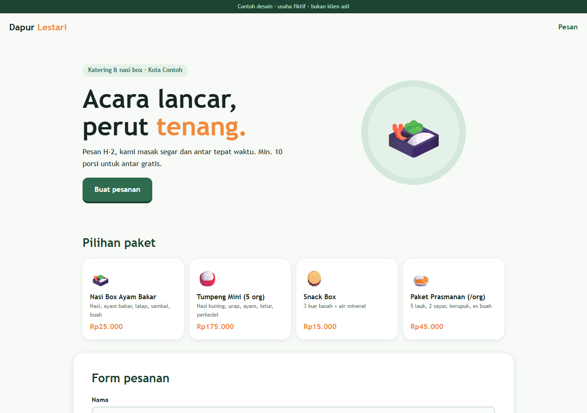
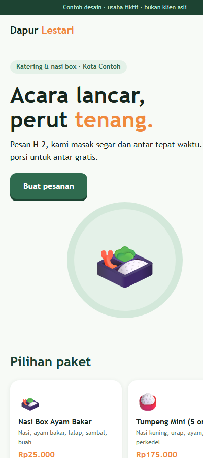
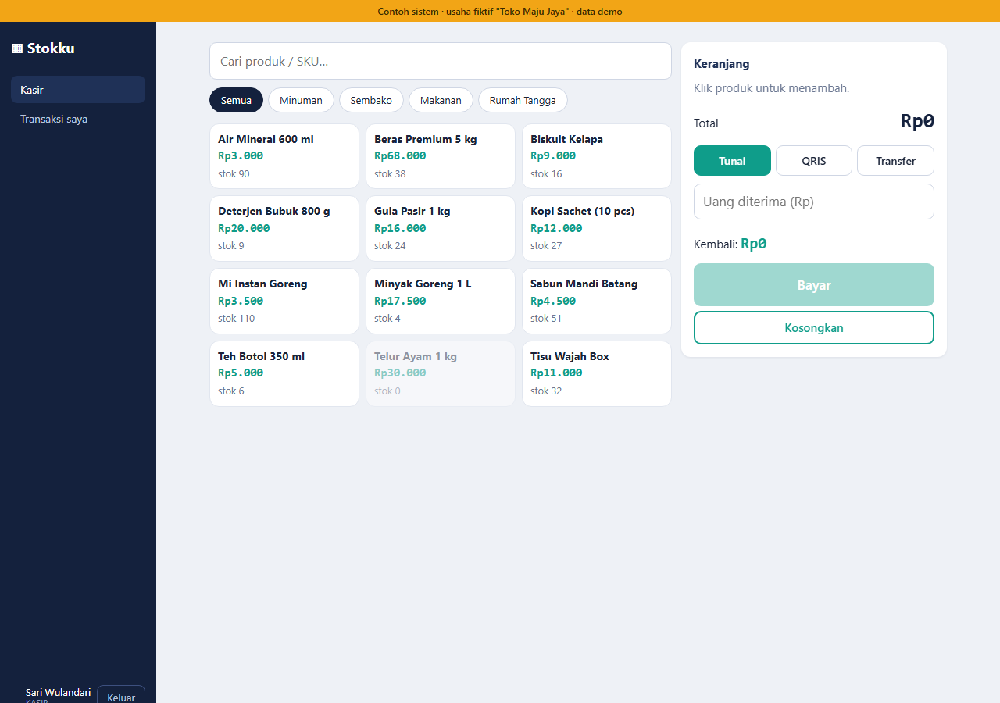
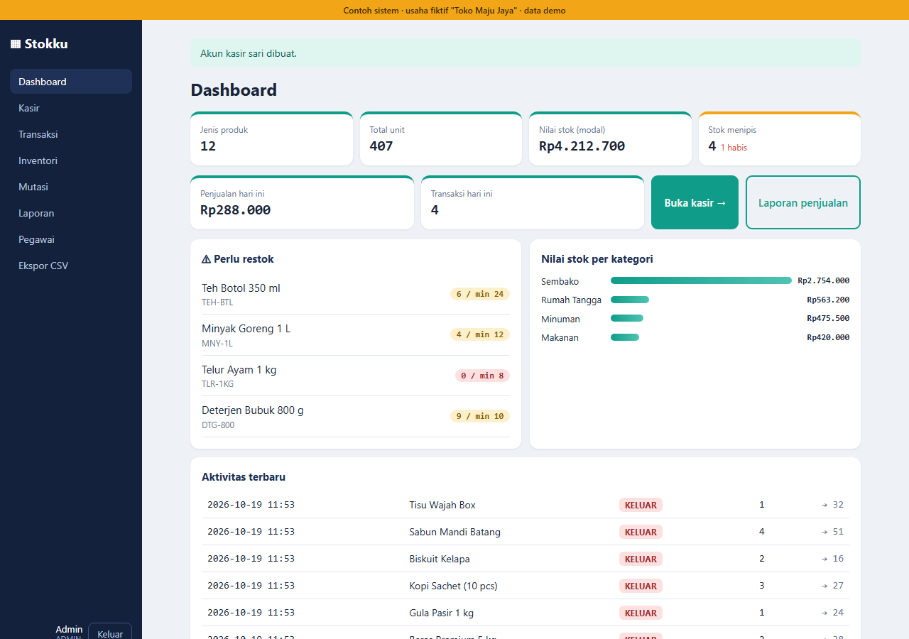
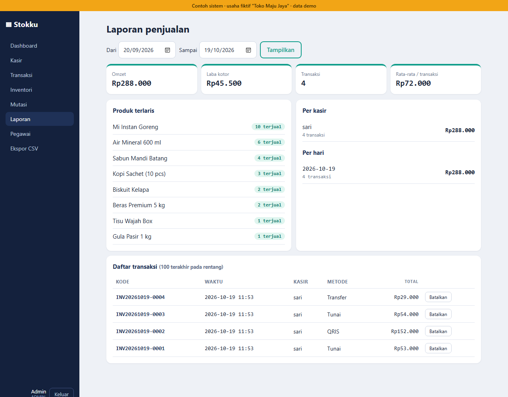
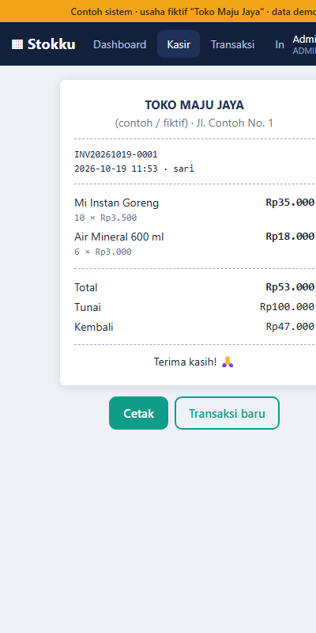

# Portofolio Website & Aplikasi untuk UMKM

Empat contoh proyek untuk usaha kecil: dua **website profil** (statis) dan dua **aplikasi dengan back-end** (Python Flask + SQLite). Semua usaha di dalamnya **fiktif**, dibuat sebagai contoh pekerjaan, bukan klien asli. Tidak ada gambar berhak cipta (hanya CSS dan emoji), dan semuanya responsif sampai lebar HP ±400 px.

| # | Proyek | Jenis | Teknologi |
|---|---|---|---|
| 1 | [Warung Bu Ningsih](#1-warung-bu-ningsih--website-profil-kuliner) | Profil usaha kuliner | HTML, CSS, JavaScript |
| 2 | [Pangkas Rapi](#2-pangkas-rapi--website-profil-jasa) | Profil usaha jasa (barbershop) | HTML, CSS, JavaScript |
| 3 | [Dapur Lestari](#3-dapur-lestari--form-pesanan--admin) | Katering: form pesanan + admin | Python, Flask, SQLite |
| 4 | [Stokku](#4-stokku--kasir--inventori-dua-peran) | Kasir (POS) + inventori, dua peran | Python, Flask, SQLite |

---

## 1. Warung Bu Ningsih — website profil kuliner

Website satu halaman untuk warung makan. Pengunjung langsung melihat menu, jam buka, dan tombol pesan lewat WhatsApp.

  
  

- Menu dengan filter makanan/minuman dan harga
- Galeri placeholder (siap diganti foto asli)
- Jam buka dengan status **buka/tutup otomatis** sesuai jam pengunjung
- Tombol WhatsApp melayang, kartu lokasi
- Tanpa framework dan tanpa dependensi, tiga file ringan

**Menjalankan:** buka `1-warung-kuliner/index.html` di browser.

---

## 2. Pangkas Rapi — website profil jasa

Website barbershop dengan gaya gelap dan tegas, berbeda total dari proyek 1. Fokusnya daftar layanan, harga, bukti sosial, dan ajakan booking.

  
  

- Daftar layanan dan harga
- Testimoni yang berganti otomatis (bisa dipilih manual)
- Tombol booking lewat WhatsApp dengan pesan terisi otomatis
- Tanpa framework dan tanpa dependensi

**Menjalankan:** buka `2-jasa-barbershop/index.html` di browser.

---

## 3. Dapur Lestari — form pesanan + admin

Website katering dengan **back-end sungguhan**: pesanan dari pelanggan tersimpan ke database, dan pemilik usaha mengelolanya lewat halaman admin.

  
  

- Form pesanan dengan estimasi total langsung, divalidasi di server
- Penyimpanan ke SQLite, halaman "terima kasih" dengan nomor pesanan
- Halaman admin: login, filter status, ubah status pesanan, ringkasan omzet, ekspor CSV
- Kata sandi admin dari variabel lingkungan (`ADMIN_PASSWORD`), tidak ada di kode
- Token CSRF, query berparameter, output di-escape

**Menjalankan:** lihat [`3-katering-flask/README.md`](3-katering-flask/README.md).

---

## 4. Stokku — kasir + inventori, dua peran

Aplikasi internal untuk toko kecil. **Kasir** (pegawai) melayani penjualan, **admin** (pemilik) mengelola stok, laporan, dan pegawai. Keduanya terhubung: setiap penjualan otomatis mengurangi stok.

  
  

  
  

| Peran | Bisa apa |
|---|---|
| **Kasir** | Layar kasir: cari/pilih produk, keranjang, bayar tunai/QRIS/transfer, kembalian otomatis, struk cetak, rekap transaksi dan kas harian miliknya |
| **Admin** | Semua fitur kasir, ditambah dashboard, CRUD produk, mutasi stok, laporan (omzet, laba kotor, terlaris, per kasir/hari), pembatalan transaksi, kelola akun kasir, ekspor CSV |

Yang ditonjolkan secara teknis:
- **Transaksi atomik:** stok dicek dan dikurangi dalam satu transaksi database. Kalau satu item kurang, seluruh penjualan batal.
- **Harga dihitung di server**, bukan dipercaya dari browser.
- **Hak akses per peran**, sandi kasir di-hash, pembatasan percobaan login.
- **Struk menyimpan salinan harga** saat transaksi, jadi laporan lama tetap benar meski produk diubah.
- **20 tes otomatis** (login, CSRF, peran, stok, pembatalan, XSS, CSV).

**Menjalankan:** lihat [`4-inventory-flask/README.md`](4-inventory-flask/README.md).

---

## Catatan

- Nomor WhatsApp, alamat, harga, dan data di screenshot adalah **data contoh**.
- Proyek 3 dan 4 adalah purwarupa untuk portofolio. Untuk dipakai klien nyata masih perlu HTTPS, WSGI server (mis. `waitress`/`gunicorn`), dan pencadangan database. Batasannya dijelaskan di README masing-masing.
- Tertarik membuat website atau aplikasi serupa untuk usaha Anda? Hubungi lewat profil GitHub ini.
